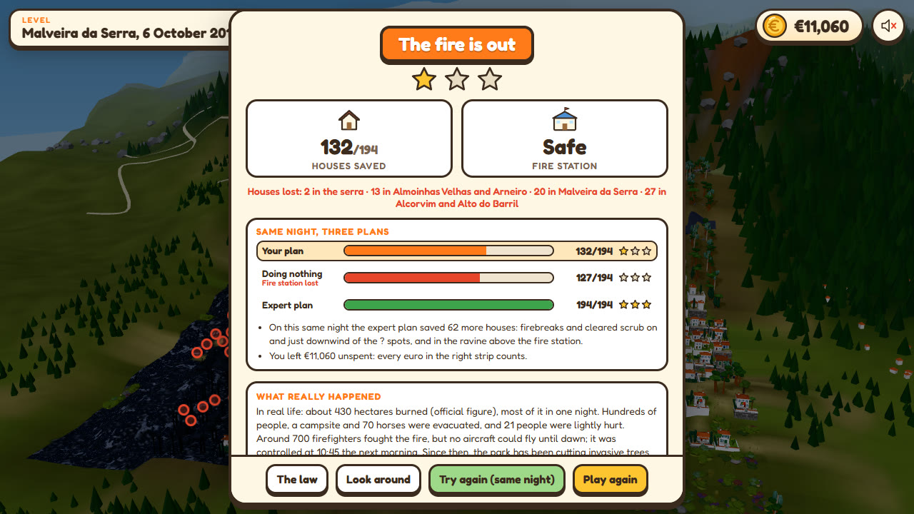

# Brace (working title) — GenHacks 2026

**▶ Play it in your browser (no account needed): https://pdramos.github.io/genhacks-2026/**
Works on a computer and on a phone held sideways.

> **Spend €20,000 to fire-proof a real Portuguese village, then watch the real hourly wind of
> 6 October 2018 test your plan.**


**Who it is for:** 12–17-year-olds who live in Portuguese villages next to forest, and their
teachers. The kids take the lesson home to the parents who own the land and have to clear it.

## The real night

Saturday 6 October 2018, 22:50, Serra de Sintra, near Lisbon. A north wind of 33 km/h, gusting to
68 km/h, roared down the mountain. A fire started near the Peninha sanctuary and ran downhill towards
Malveira da Serra. About **430 hectares** burned (official ICNF figure), hundreds of people were
evacuated, around **700 firefighters** fought it, and no aircraft could fly until dawn.

Portuguese law (Decreto-Lei 82/2021, art. 49.º) already says what should be done before a night
like that: clear fuel strips of **100 m** around villages next to forest, **50 m** around houses on
forest land, and **10 m** on each side of roads. Few people know it, and fewer do it.

## How you play

1. **Prepare (€20,000).** The map is the real village: 32 × 32 tiles of 65 m, with **194 houses**
   and the fire station. Clear brush (from €200), cut a firebreak (from €500) or swap eucalyptus
   for native trees (from €800). Steeper ground and thicker fuel cost more. You can only work where the law puts the fuel strips:
   those tiles glow. The natural park is locked.
2. **The night.** Six **"?"** marks show where a cigarette could land on a dry verge. A seed picks
   the one where tonight's fire starts. Then the **real hourly wind of that night**
   (ERA5, via Open-Meteo) pushes the fire, hour by hour, with flying embers in the gusts.
3. **The result.** Stars for houses saved, but **no stars if the fire station burns**. Then the game
   replays **the same night** twice, in secret: once doing nothing and once with an expert plan. You
   see if your work saved the houses, or if it was luck. "Try again (same night)" lets you fix your
   plan against the same fire, and "The law" card explains the strips with the official link.




## How we tested it

- **219 automated tests** (`npm test`, Node's built-in `node:test`): rules, map checks, the law
  strips, ignition, the real wind, the result lessons, the quiz maths and the validation grid.
- **Balance:** a test plays the level on **120 seeds** with 8 different strategies. The fire is
  deterministic: the same seed gives the same night in Node and in the browser.

  | Strategy | Avg stars | 3★ nights | Money spent |
  |---|---:|---:|---:|
  | Do nothing | 0.59 | 12% | €0 |
  | Spend everything from the top-left | 0.79 | 18% | €20,000 |
  | Random | 0.82 | 15% | €19,927 |
  | Firebreak on every "?" | 0.72 | 12% | €3,650 |
  | Protect only the fire station | 1.14 | 15% | €4,650 |
  | A sensible plan | 1.62 | 20% | €18,590 |
  | **Expert plan** (tuned by computer) | **2.49** | **73%** | €20,000 |

  Thinking pays: the expert plan saves every house in 73% of the nights, against 12% for doing
  nothing, and spending the money blindly is barely better than doing nothing.
- **Against the real fire:** we compared our fire model with the official map of what really burned
  in 2018, over **1000 nights**. See below.
- **With players:** `?playtest=1` adds a 5-question anonymous quiz before and after playing, to
  measure what players learned. Results stay on that device and export as CSV.
- **Clicks:** 180 of 180 test clicks on glowing tiles landed, from 3 camera views, with all 3 tools
  (before a fix, 159 of 180: trees and houses got in the way).

## How close is the fire to the real one?

Full details in [docs/validation.md](docs/validation.md); run it yourself with `npm run validate`
(about 15 s). With no player actions, from the real start, over 1000 nights:

| Run | Hit rate | False alarms | Sørensen (overlap) |
|---|---:|---:|---:|
| **Model, real wind** | **82.2%** | 45.9% | **0.65** |
| Same model, no wind | 51.7% | 57.2% | 0.47 |
| A circle with the true burned area | 67.8% | 32.2% | 0.68 |

The real wind clearly matters (82% of the real burned tiles against 52% without wind). But the model
burns too much to the east and in the south-centre (there are no firefighters in it, and about 700
fought that fire), and **a simple circle with the right area scores slightly better on the official
map** (0.68 vs 0.65). We say so plainly: the game teaches where to work, it is not a fire forecast.

## Limitations (what we have not proven yet)

- **One fire, one night.** The validation shows how the model compares on this night only.
- **Most of the real fire is off the map.** Only 23% of the burned area is inside our 2.1 km map.
- **The fire rules are game rules**, tuned for play, not fire physics. No firefighters, no time of
  day.
- **The ground is from today.** The vegetation comes from OpenStreetMap in 2026; after the fire, the
  park cut invasive trees and replanted.
- **Learning is not measured yet.** The quiz is built; the playtests with real players are still to
  be done.
- **A firebreak on a "?" can make the night worse:** the cigarette rolls into the dry scrub beside it.
  The result screen tells the player when that happens.

## What's new here

The "budget → prepare → disaster" loop is not new: the UN's *Stop Disasters!* (2007) did it, and
fire models such as *GridFire* spread fire on a grid far more accurately than we do. What we add:
a **real night** (real village, real terrain, real hourly wind), the **law as the puzzle** (it says
where you may work; the slope says what it costs), a **hidden start** you can replay on the **same
night**, a **"same night, three plans" comparison** that separates skill from luck, and a fire model
**checked in public against the official burned area**, including where it fails.


## How to run it

No build tools are needed.

```
python dev/serve.py
```

(It works like `python -m http.server 8000`, but tells the browser not to cache, so it always runs
the newest code.) Then open <http://localhost:8000/>. Useful extras: `?seed=7` replays one night,
`?playtest=1` turns on the quiz, `?style=canada` shows another style, and
`gallery.html?style=sintra` shows every 3D piece of a style.

```
npm test          # 219 tests, including the balance check
npm run validate  # the fire model against the real 2018 burned area
```

## How it is made

- `src/sim/` — the rules (village, actions, fire, stars, the same-night comparison, the quiz). Plain
  JavaScript, no graphics, tested with Node's built-in `node:test`.
- `src/render/` — the 3D view (Three.js). It only reads the simulation.
- `data/levels/` — the levels (map, heights, budget, real wind, story, law and sources).
- `dev/validate.js` — the check against the real burned area.
- All graphics and sounds are **generated in code**: no downloaded models, images, textures or audio.

```
real data (OpenStreetMap, Copernicus DEM, ERA5 wind) → 32×32 level file → rules (src/sim) → 3D view (src/render)
```

## Credits and licences

**Code library**
- [Three.js](https://threejs.org/) 0.186.1 — MIT licence, loaded from the jsDelivr CDN.
- Font: [Fredoka](https://fonts.google.com/specimen/Fredoka) from Google Fonts — SIL Open Font Licence.

**Data**
- **Weather:** [Open-Meteo](https://open-meteo.com/) historical weather API (ERA5 archive, Copernicus
  Climate Change Service) — CC BY 4.0. The hourly wind, gusts, temperature and humidity of
  6–7 October 2018 at the Peninha ridge.
- **Map:** Map data © [OpenStreetMap contributors](https://www.openstreetmap.org/copyright),
  Open Database Licence (ODbL 1.0). Roads, buildings and land cover around Malveira da Serra,
  retrieved through the Overpass API and turned into a 32 × 32 tile map (some tiles are game choices:
  the fire station stand-in and the dry verges where the cigarette can fall).
- **Elevation:** [Open-Meteo Elevation API](https://open-meteo.com/en/docs/elevation-api) (CC BY 4.0),
  based on the Copernicus DEM GLO-90 (© DLR e.V. 2010-2014 and © Airbus Defence and Space GmbH
  2014-2018, provided under COPERNICUS by the European Union and ESA).
- **The law:** Decreto-Lei 82/2021, art. 49.º,
  [Diário da República](https://diariodarepublica.pt/dr/detalhe/decreto-lei/82-2021-172745163).
- **The real story** (briefing and "what really happened"): news reports listed in the level's
  `sources` (Observador, DN, CM Jornal, RTP, Euronews, Inquirer, Sábado). They are also linked on the
  results screen in the game.
- **Real burned area (only for the model check, not shown in the game):** ICNF, Cartografia nacional
  de áreas ardidas 2018, https://si.icnf.pt/wfs/areas_ardidas. Cross-check: Copyright (C) European
  Union, 1995-2025, EFFIS, Copernicus Emergency Management Service, CC BY 4.0 (changed: cut into the game
  grid). Only the derived 32 × 32 grids are in `data/validation/`. Details in
  [docs/validation.md](docs/validation.md).

The game shows the weather, map and elevation credits on the briefing and results screens.

**Early spike (removed):** in the first days we briefly tried free Kenney 3D models (CC0, public
domain). They were never committed to this repository and the final game uses none of them: every
house, tree and flag is now built in code.

## Licence

The source code is under the [MIT licence](LICENSE). The map data in `data/levels/sintra.json` is
derived from OpenStreetMap and stays under the **ODbL 1.0**; the weather and elevation data stay under
CC BY 4.0 (see above).

## Use of AI

This project is made by a 16-year-old student who is learning to program from scratch. Most of the
code was written by **Claude Code (Anthropic)**, an AI coding assistant, in small steps that the
student directed, tested and explained back in their own words. The student made the design decisions
(the game idea, the real fire, the look of the town, the difficulty goals). AI was also used to help
gather the real data and the news sources listed above, to tune the expert plan, and to review the
code. No AI-generated images, models or sounds are used: everything you see and hear is drawn or
synthesised by the game's own code.
