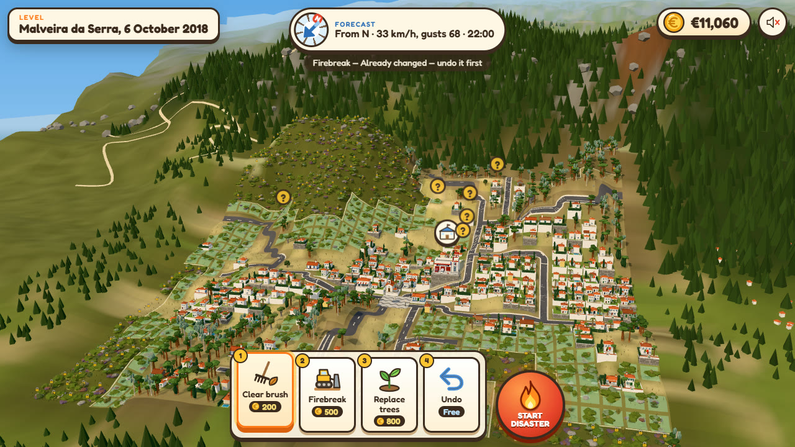
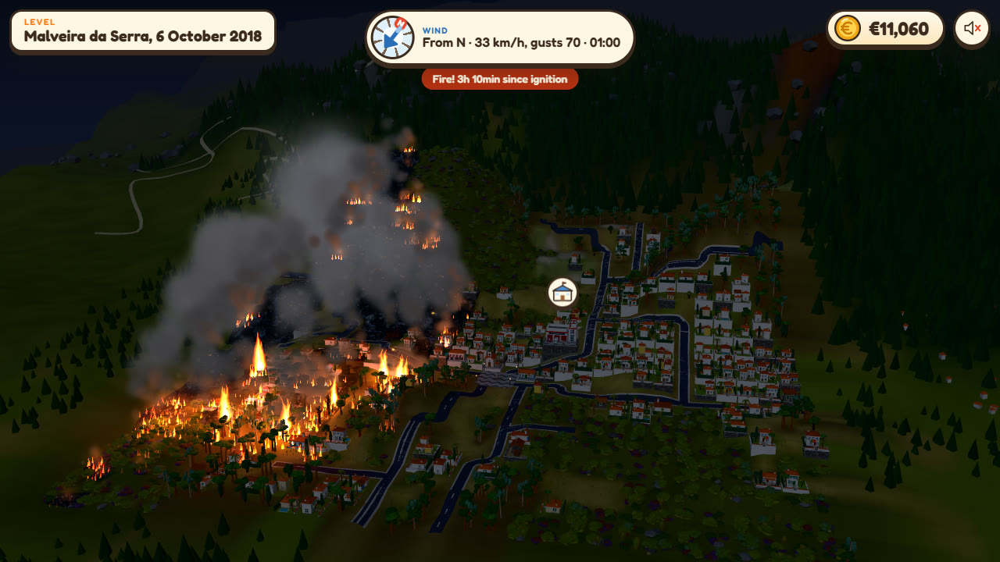
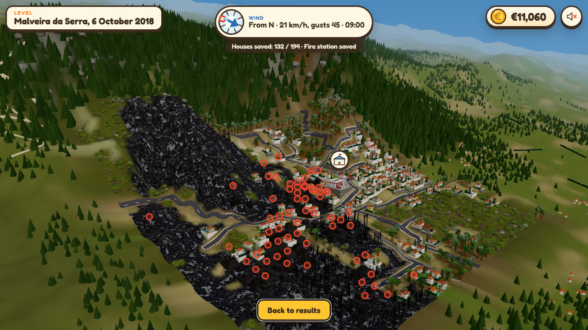

# Same Night: one real wildfire, three plans

**▶ Play it in your browser: https://pdramos.github.io/genhacks-2026/?seed=1960** (no account, nothing to
install; made for a computer browser; the link opens a night chosen for learning) · GenHacks 2026, Healthcare & Environmental track

> **A 3D game: prepare a real Portuguese village for the 2018 wildfire that forced 347 people out;
> that night's real wind drives the fire. Our fire matches the official burn map at
> 0.65 (1 = identical).**

- **The problem:** on 6 October 2018, a wildfire burned about 430 hectares of scrub and forest near
  Lisbon, Portugal. It forced 347 people out of nearby villages and a campsite, and 21 were lightly
  hurt, most of them firefighters. Portugal's law says exactly where to clear fuel around villages,
  houses and roads next to forests, to keep fire away from people, but a rule on paper is hard to picture until the fire comes.
- **The game:** you spend €20,000 on the real village of Malveira da Serra, only where Portuguese law
  says fuel must be cleared. Then the real wind of that night pushes the fire, and **"Same night,
  three plans"** shows your plan next to doing nothing and an expert plan, on the exact same fire.
- **Why believe it:** over 1,000 runs from the map tile nearest the recorded start, our fire's
  overlap with the official burned-area map (0 = none, 1 = identical) is 0.65 with the real wind of
  that night and 0.47 without it ([how we checked](docs/validation.md)). For scale, two official maps
  of this same fire agree at only 0.78, and a plain circle around the start, told the true burned area, scores 0.68 (a bit more than
  ours), so we claim the direction of the fire (the wind matters), not its exact shape. Rerun it: `npm test` · `npm run validate`.
  What we have not proven: [Limitations](#limitations-what-we-have-not-proven-yet).



**Who it is for:** 12- to 17-year-olds who live in Portuguese villages next to forest, and their
teachers. Our aim is that they take what they learn home, to the adults who own the land and have
to clear it.

## The real night

Saturday, 6 October 2018, 22:50, Serra de Sintra, near Lisbon. A fire started near the Peninha
sanctuary and came down the mountain along the west side of Malveira da Serra, towards the coast, pushed by a north wind of 33 km/h
with gusts near 70 km/h. Around **700 firefighters** fought it, with no aircraft until dawn.

Portuguese law (Decreto-Lei 82/2021, art. 49.º) already says what should be done before a night
like that: clear fuel strips of **100 m** around villages next to forest, **50 m** around houses on
forest land, and **10 m** on each side of roads. These strips exist to protect people: they keep fire
further from homes and from the roads people use to get out. But a law on paper does not clear a
single hectare.

## How you play

1. **Prepare (€20,000).** The map is the real village: 32 × 32 tiles of 65 m, with **194 house
   tiles** (65 m blocks of real buildings) and the fire station. Clear brush (from €200), cut a
   firebreak (from €500) or swap eucalyptus for native trees (from €800). Steeper ground costs more,
   and a firebreak through trees costs double (€1,000). You can only work where the law puts the fuel
   strips: those tiles glow. The natural park is locked.
2. **The night.** Six **"?"** marks show where a cigarette could land on a dry verge. A seed picks
   the one where tonight's fire starts. Then the **real wind of that night** (ERA5, via Open-Meteo)
   pushes the fire, with flying embers in the gusts.
3. **The result.** Stars for houses saved, but **no stars if the fire station burns**. Then the game
   replays **the same night** twice, in secret: once doing nothing and once with an expert plan. You
   see if your work saved the houses, or if it was luck. "Try again (same night)" lets you fix your
   plan against the same fire, and "The law" card explains the strips with the official link.




## How we tested it

- **231 automated tests** (`npm test`, Node's built-in `node:test`): rules, map checks, the law
  strips, ignition, the real wind, the result lessons, the quiz maths and the validation grid.
- **Balance:** a test plays the level on **120 seeds** with 8 different strategies. The fire is
  deterministic: the same seed gives the same night in Node and in the browser.

  | Strategy | Avg stars | 3★ replays | Money spent |
  |---|---:|---:|---:|
  | Do nothing | 0.65 | 10% | €0 |
  | Spend everything from the top-left | 0.77 | 13% | €20,000 |
  | Random | 0.78 | 13% | €19,927 |
  | Firebreak on every "?" | 0.63 | 12% | €3,650 |
  | Clear brush around every "?" | 0.85 | 16% | €3,350 |
  | Protect only the fire station | 1.15 | 9% | €4,650 |
  | A sensible plan | 1.68 | 16% | €18,590 |
  | **Expert plan** (tuned by computer on other seeds of this night) | **2.47** | **68%** | €20,000 |

  Thinking pays: the expert plan saves every house and the fire station in 68% of the replays, against 10% for doing
  nothing, and spending the money blindly is barely better than doing nothing. The expert plan was
  tuned by computer on other random versions of this same night (same map, same six "?" spots, same
  wind; seeds 3001-3400 and 5001-5300), not on these 120. So 68% shows that a plan can work on this
  night, not that it works on other fires.
- **No free wins.** On 24% of these 120 nights (29% of 2,000 with `BALANCE_SEEDS=2000`), doing nothing already earns 2 or 3
  stars, because the wind takes the fire away from the village. A player who got one of those first
  would think doing nothing wins. So a new game never deals one: it draws another night
  (`pickNightSeed` in `src/sim/counterfactual.js`). On the 91 nights it can deal, doing nothing
  averages 0.09 stars and the expert plan still saves everything on 68% (the second table that
  `tests/balance.test.js` prints).
- **Fair dice:** every tile has its own fixed "dice" for each 10-minute step, so changing one tile
  only changes the fire where that tile matters. Before this, one change reshuffled the whole night.
  A test (`tests/counterfactual.test.js`, "the judge night") now checks that none of the 21 actions
  of an AI judge-style playtest makes the night worse on its own. That is what makes "Try again (same night)" a
  fair test of your plan.
- **Against the real fire:** we compared our fire model with the official map of what really burned
  in 2018, over **1,000 runs**. See below.
- **With players:** `?playtest=1` adds a 5-question anonymous quiz before and after playing, to
  measure what players learned. Results stay on that device and export as CSV.

## How close is the fire to the real one?

Full details in [docs/validation.md](docs/validation.md); run it yourself with `npm run validate`
(about 15 s). With no player actions, from the map tile nearest the recorded start, over 1,000 runs:

| Run | Real burned tiles it also burns | Its burned tiles that did not really burn | Sørensen (overlap, 0 to 1) |
|---|---:|---:|---:|
| **Model, real wind** | **81.0%** | 45.4% | **0.65** |
| Same model, no wind | 51.7% | 57.2% | 0.47 |

The real wind clearly matters (81% of the real burned tiles against 52% without wind). But the model
burns too much to the east and in the south-centre (one possible reason, not tested: there are no
firefighters in it, and about 700 fought that fire). As the top of this page says, we claim the direction of the fire, not its exact
shape: the game teaches where to work, it is not a fire forecast.

## Limitations (what we have not proven yet)

- **One fire, one night.** The check shows how the model compares on this night only.
- **Most of the real fire is off the map.** Only about 23% of the fire (101 of its 429 ha) lies inside our 2.1 km map.
- **The game's fires are a "what if".** The check above starts the fire at the map tile nearest the
  recorded start. In the game, it starts at one of six "?" spots, five of them on the east side of the
  map, while the real fire burned mostly down the west side, under the same real wind. So a game
  night burns different ground and is not meant to copy the real burned area (from those spots, the
  overlap with it is only 0.07).
- **The exact start point is not public.** ICNF gives only a place name (Fonte da Peninha), so we used
  that spring's position on OpenStreetMap, about 360 m north of the map. The score depends on which
  start tile we use (details in validation.md).
- **The fire rules are game rules**, tuned for play, not fire physics. No firefighters, no aircraft,
  no time of day.
- **The ground is from today.** The vegetation comes from OpenStreetMap in 2026, and the park has
  replanted since the fire.
- **A firebreak on a "?" can make the night worse:** the cigarette rolls into the dry scrub beside
  it. The result screen only explains this on nights when doing nothing would have saved every house.
- **Some parts are game choices.** The cigarette is a dramatization: the real cause of the fire was
  never confirmed. The fire station is a stand-in, placed where the real primary school is, because
  Malveira has no fire station. When you work on a "?", the cigarette looks for the nearest dry tile
  in a fixed order that starts on the north side. That is a simplification, and part of the expert
  plan's edge depends on it.
- **The law is rounded up to whole 65 m tiles,** so the game's strips are wider than the law's: up to
  2 tiles (about 130 m) from any house or the fire station, and a whole tile beside each road, where
  the law asks for 10 m. Houses are counted as 65 m tiles, not single buildings.
- **The game is in English**, for this hackathon's judges; the players it is made for speak
  Portuguese. A Portuguese version is the first item in "What's next".
- **Learning is not measured yet.** The quiz is built, but we have not run it with enough players to
  report a number.
- **Made for a computer browser** with 3D graphics (WebGL) turned on. Not tested on phones.

## What's new here

The "budget → prepare → disaster" loop is not new: the UN's *Stop Disasters!* (2007) did it, and
research fire models such as *GridFire* are built to predict how fire spreads; ours is built for
play. What we add: a **real night** (real village, real terrain, the real wind of that night), the
**law as the puzzle** (it says where you may work; the slope and the trees say what it costs), a **hidden start** you can replay on the **same
night**, a **"same night, three plans" comparison** that separates skill from luck, and a fire model
**checked in public against the official burned area**, including where it fails.



## How to run it

No build tools are needed.

```
python dev/serve.py
```

(It works like `python -m http.server 8000`, but tells the browser not to cache, so it always runs
the newest code.) Then open <http://localhost:8000/>. Useful extras: `?seed=7` replays one night,
`?playtest=1` turns on the quiz, and `gallery.html?style=sintra` shows every 3D piece, all built in
code.

```
npm test          # 231 tests, including the balance check
npm run validate  # the fire model against the real 2018 burned area
```

## How it is made

- `src/sim/` — the rules (village, actions, fire, stars, the same-night comparison, the quiz). Plain
  JavaScript, no graphics, tested with Node's built-in `node:test`.
- `src/render/` — the 3D view (Three.js). It only reads the simulation.
- `data/levels/` — the levels (map, heights, budget, real wind, story, law and sources).
- `dev/validate.js` — the check against the real burned area.
- All graphics and sounds are **generated in code**: no downloaded models, images, textures or audio.

```
real data (OpenStreetMap, Copernicus DEM, ERA5 wind) → 32×32 level file → rules (src/sim) → 3D view (src/render)
```

## Credits and licences

**Code library**
- [Three.js](https://threejs.org/) 0.186.1 — MIT licence, loaded from the jsDelivr CDN.
- Font: [Fredoka](https://fonts.google.com/specimen/Fredoka) from Google Fonts — SIL Open Font License.

**Data**
- **Weather:** [Open-Meteo](https://open-meteo.com/) historical weather API (ERA5 archive, Copernicus
  Climate Change Service) — CC BY 4.0. The hourly wind, gusts, temperature and humidity of
  6–7 October 2018 at the Peninha ridge.
- **Map:** Map data © [OpenStreetMap contributors](https://www.openstreetmap.org/copyright),
  Open Database License (ODbL 1.0). Roads, buildings and land cover around Malveira da Serra,
  retrieved through the Overpass API and turned into a 32 × 32 tile map (some tiles are game choices:
  the fire station stand-in and the dry verges where the cigarette can fall).
- **Elevation:** [Open-Meteo Elevation API](https://open-meteo.com/en/docs/elevation-api) (CC BY 4.0),
  based on the Copernicus DEM GLO-90 (© DLR e.V. 2010-2014 and © Airbus Defence and Space GmbH
  2014-2018, provided under COPERNICUS by the European Union and ESA).
- **The law:** Decreto-Lei 82/2021, art. 49.º,
  [Diário da República](https://diariodarepublica.pt/dr/detalhe/decreto-lei/82-2021-172745163).
- **The real story** (briefing and "what really happened"): news reports listed in the level's
  `sources` (Observador, DN, CM Jornal, RTP, Euronews, Inquirer, Sábado). They are also linked on the
  results screen in the game.
- **Real burned area (only for the model check, not shown in the game):** ICNF, Cartografia nacional
  de áreas ardidas 2018 (fire RO2182659), open WFS map service (for GIS software, not a web page):
  https://si.icnf.pt/wfs/areas_ardidas?service=WFS&request=GetCapabilities. Cross-check: Copyright (C) European
  Union, 1995-2025, EFFIS, Copernicus Emergency Management Service, CC BY 4.0 (changed: cut into the game
  grid). Only the derived 32 × 32 grids are in `data/validation/`. Details in
  [docs/validation.md](docs/validation.md).

The game shows the weather, map and elevation credits on the briefing and results screens.

**Early spike (removed):** in the first days we briefly tried free Kenney 3D models (CC0, public
domain). They were never committed to this repository and the final game uses none of them: every
house, tree and flag is now built in code.

## Licence

The source code is under the [MIT licence](LICENSE). The map data in `data/levels/sintra.json` is
derived from OpenStreetMap and stays under the **ODbL 1.0**; the weather and elevation data stay under
CC BY 4.0 (see above).

## Use of AI

This project is made by a 16-year-old student in Portugal who is learning to program from scratch,
with the AI tools the student directed. The rules ask us to list all AI use, so here it is.

- **What the student decided:** the game idea, the real fire and village, the look of the village,
  that every graphic is made in code, the difficulty goals, and what to build and what to cut. At the
  end of each milestone, the student explained back in their own words what the new part does before
  moving on.
- **What AI did:** **Claude Code (Anthropic)**, an AI coding assistant, wrote most of the code and
  the tests, in small steps that the student asked for and tested in the game. AI also helped gather
  the real data and the news sources, helped tune the expert plan (a computer search on other random
  versions of this night) and reviewed the code. AI agents played the game the way a judge would
  (that is how the luck problem in "Fair dice" was found), researched what past hackathon winners did,
  helped plan the work, wrote most of the in-game text (briefing, lessons and quiz questions), acted
  as simulated judges to critique drafts of the Devpost page, and helped draft that page and this
  README.
- **What AI did not make:** no AI-generated images, 3D models, sounds or voices. Every image, 3D model
  and sound is drawn or synthesized by the game's own code (the only outside asset is the free
  Fredoka font). There is no AI inside the game.
